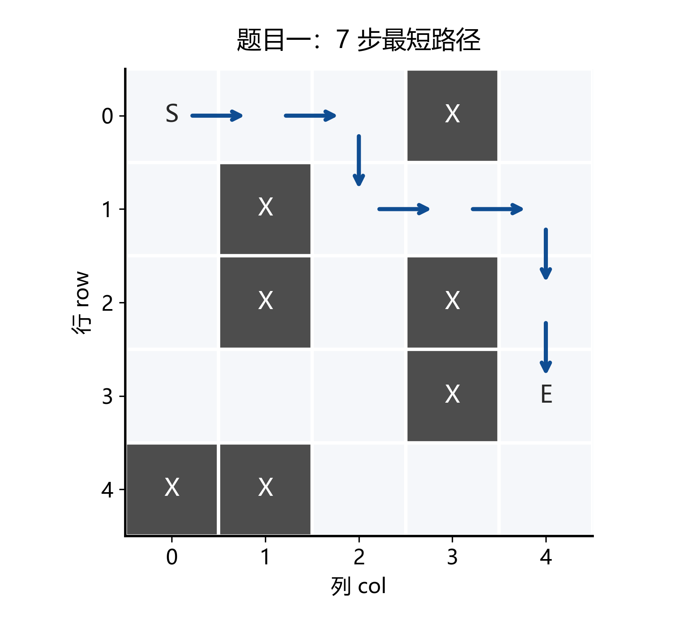
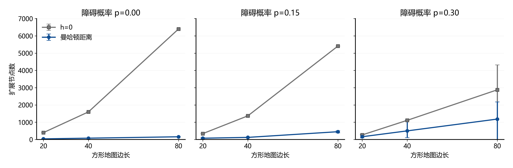
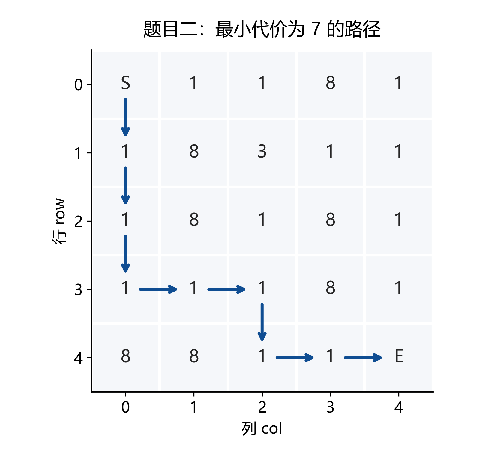
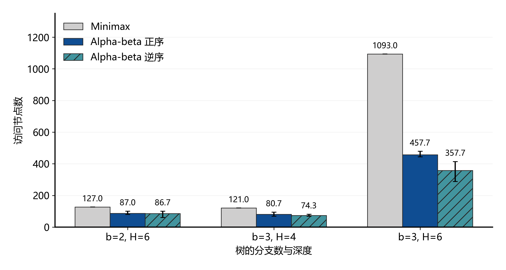
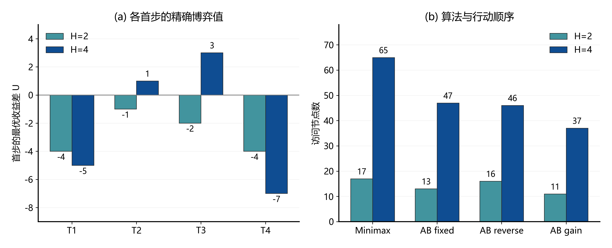

# 当代人工智能实验二：搜索算法

## 1. 实验目标、算法设计与实验设置

### 1.1 实验目标

本实验通过迷宫寻路、加权地形、极大极小博弈树和宝藏分配四个问题，实现 A*、Minimax 与 Alpha-beta 剪枝。实验围绕启发函数、节点访问顺序和搜索深度开展对照，记录解的质量、搜索节点数与运行时间，分析不同搜索策略的作用。

### 1.2 A* 的状态与优先队列

寻路状态为网格坐标 `(row, col)`，每个状态最多有上、下、左、右四个邻居。使用以下评价函数：

$$
f(n)=g(n)+h(n)
$$

其中，g 为从起点到当前节点的已知最小代价，h 为当前节点到终点的估计代价。第一题每步代价为 1；第二题和第四题按进入相邻格的地形权值累计代价。

程序使用最小堆维护待搜索节点，堆条目为 `(f, h, 序号, g, 坐标)`。优先选择 f 较小的节点，f 相同时选择 h 较小的节点，再按入队顺序处理；邻居顺序固定为右、下、左、上。发现更低的 g 时更新代价与父节点，并将新记录入队。旧记录出队时根据 g 判断是否跳过。终点出队后，沿父节点重建路径。

第一题的启发函数为曼哈顿距离：

$$
h(n)=|r-r_E|+|c-c_E|
$$

四方向移动每次最多使曼哈顿距离减少 1，因此该距离是到达终点所需步数的下界。将 h 设为 0 时，A* 按累计代价搜索，在单位代价网格上逐层向外扩展。

### 1.3 Minimax 与 Alpha-beta

Minimax 从根节点开始交替执行 MAX 与 MIN 决策：

$$
V(s)=
\begin{cases}
\operatorname{Eval}(s), & s\text{ 为叶子或达到搜索深度} \\
\max\limits_{a\in A(s)} V(T(s,a)), & s\text{ 为 MAX 节点} \\
\min\limits_{a\in A(s)} V(T(s,a)), & s\text{ 为 MIN 节点}
\end{cases}
$$

Alpha-beta 在同一递归过程中维护 α 和 β。α 表示 MAX 已获得的下界，β 表示 MIN 已获得的上界。MAX 更新 α，MIN 更新 β，当 α ≥ β 时结束当前节点剩余子分支的搜索。例如，MIN 已有值为 5 的选择，而另一 MAX 子分支已得到 6，该子分支继续搜索也不会成为 MIN 的更优选择。

第三题直接搜索给定博弈树；第四题根据双方位置、剩余宝藏和累计收益生成后继状态。第四题搜索到指定深度或宝藏取完时，返回当前双方收益差。

### 1.4 实验环境与对照实验

| 项目 | 设置 |
| --- | --- |
| 操作系统 | Windows 11，版本 10.0.26200 |
| Python | 3.12.7 |
| 处理器架构 | AMD64，16 个逻辑处理器 |
| 算法依赖 | Python 标准库 |
| 统一实验脚本 | `experiments.py` |
| 随机种子 | 20261111 |
| 每组随机输入数量 | 3 |
| 计时方式 | 每种配置预热 1 次，重复 31 次，取中位数 |

在同一输入上改变启发函数、算法或访问顺序，其余设置保持一致。地图大小、障碍概率、树结构和宝藏价值作为输入条件分别变化。

| 题目 | 输入组数 | 对照因素 | 结果校验 |
| --- | ---: | --- | --- |
| 一 | 30 | h=0、曼哈顿距离；地图大小、障碍概率 | BFS 最短步数与路径检查 |
| 二 | 13 | h=0、修正启发函数；地形权值、地图大小 | Dijkstra 最小代价与路径累计 |
| 三 | 11 | Minimax、Alpha-beta；正序、逆序；分支数、深度 | 完整递归评价 |
| 四 | 7 | 两种博弈算法；H=2、H=4；三种访问顺序；宝藏价值 | Dijkstra 距离与行动序列穷举 |


## 2. 题目一：迷宫寻路

### 2.1 最短路径的形成

给定样例的起点为 `(0,0)`，终点为 `(3,4)`。程序返回：

```text
(0,0) → (0,1) → (0,2) → (1,2)
      → (1,3) → (1,4) → (2,4) → (3,4)
```



图 1：蓝色箭头表示程序返回的 7 步最短路径，深灰色格为障碍。

起点的 g=0、h=7、f=7。沿第一行向右移动到 `(0,2)` 后，右侧为障碍，路径向下到 `(1,2)`，再经过右侧通道到达终点。该路径每走一步，g 增加 1，h 减少 1，f 保持为 7；终点的 g=7。起终点的曼哈顿距离也是 7，因此这条可行路径达到步数下界。

### 2.2 启发函数对照

| 启发函数 | 最短步数 | 扩展节点 | 有效出队节点 | 已发现坐标 | 耗时 / ms |
| --- | ---: | ---: | ---: | ---: | ---: |
| h=0 | 7 | 15 | 16 | 17 | 0.0494 |
| 曼哈顿距离 | 7 | 7 | 8 | 11 | 0.0283 |

两种设置均返回 7 步路径。h=0 按距起点的步数展开，访问了多个与终点方向不同的分支；曼哈顿距离将终点方向的信息加入优先级，同 f 时优先较小 h，使搜索沿接近终点的路径推进。样例的扩展节点由 15 降到 7，减少 53.33%。

### 2.3 地图规模与障碍概率

生成边长为 20、40、80 的方形地图，起终点分别位于左上角和右下角。障碍生成概率取 0、0.15、0.30。同一尺寸同一障碍概率使用 3 个随机种子实例，表中节点数为同组 3 个实例的平均值，时间为各实例计时中位数的平均值。

| 地图 | 障碍概率 | 可达实例 | h=0 扩展节点 | 曼哈顿扩展节点 | h=0 耗时 / ms | 曼哈顿耗时 / ms |
| --- | ---: | ---: | ---: | ---: | ---: | ---: |
| 20×20 | 0.00 | 3/3 | 399.00 | 38.00 | 1.3695 | 0.1663 |
| 20×20 | 0.15 | 3/3 | 342.00 | 75.33 | 1.2138 | 0.3262 |
| 20×20 | 0.30 | 2/3 | 266.33 | 161.67 | 0.8536 | 0.6255 |
| 40×40 | 0.00 | 3/3 | 1599.00 | 78.00 | 6.0774 | 0.3466 |
| 40×40 | 0.15 | 3/3 | 1370.00 | 123.33 | 5.0074 | 0.5603 |
| 40×40 | 0.30 | 2/3 | 1111.33 | 500.33 | 4.0001 | 2.1333 |
| 80×80 | 0.00 | 3/3 | 6399.00 | 158.00 | 25.4118 | 0.7265 |
| 80×80 | 0.15 | 3/3 | 5410.67 | 452.00 | 20.2298 | 2.1704 |
| 80×80 | 0.30 | 2/3 | 2878.67 | 1184.00 | 10.5172 | 5.3408 |



图 2：点为 3 个实例的平均扩展节点数，误差线为最小值至最大值。统计包含同组的无解输入。

**无障碍地图中**，h=0 在终点出队前几乎展开整张地图，80×80 时扩展 6399 个节点。曼哈顿距离准确给出了剩余步数，同 f 时选择较小 h，扩展节点数等于最短路径的 158 步，减少 97.53%。

**障碍概率提高后**，曼哈顿距离仍给出几何距离，但绕过障碍所需的额外步数使估计与实际代价之间的差距增大。例如 80×80、p=0.30 的两个可达实例，最短步数分别为 170 和 164，曼哈顿距离搜索分别扩展 1374 和 2176 个节点。此时需要探索更多岔路才能找到最优通道。

**无解时**，搜索持续到起点所在可达区域被遍历完。例如 40×40、p=0.30 的第 3 个实例，两种设置都扩展 1130 个节点；80×80 同组第 1 个实例的起点区域只有 2 个节点，两种设置都扩展 2 个节点。

## 3. 题目二：加权地形

### 3.1 代价累计与最优路径

本题移动到相邻节点的代价等于进入格子的权值，起点不计费，进入终点 E 的代价为 0。给定样例的最优路径沿左侧和下侧的代价 1 地形前进：



图 3：路径经过 8 次移动，前 7 次进入代价为 1，最后进入 E 的代价为 0。

| 步骤 | 坐标 | 本步进入代价 | 累计 g |
| --- | --- | ---: | ---: |
| 起点 | (0,0) | 0 | 0 |
| 1 | (1,0) | 1 | 1 |
| 2 | (2,0) | 1 | 2 |
| 3 | (3,0) | 1 | 3 |
| 4 | (3,1) | 1 | 4 |
| 5 | (3,2) | 1 | 5 |
| 6 | (4,2) | 1 | 6 |
| 7 | (4,3) | 1 | 7 |
| 8 | (4,4)，E | 0 | 7 |

最终总代价为 7，与 Dijkstra 的结果一致。路径绕开了代价 3 和 8 的地形。

### 3.2 终点免费与启发函数设计

设当前位置与 E 的曼哈顿距离为 d，除终点外可通行格子的最小进入代价为 m。到达 E 至少需要 d 次移动，其中最后一次进入 E 免费，因此使用：

$$
h(n)=m\max(d(n,E)-1,0)
$$

其余至少 d−1 次移动，每次代价不小于 m，因此 h 是真实剩余代价的下界。本题样例中 m=1；与 E 相邻的节点 h=0。对于普通非终点邻居，h 每步最多减少 m，进入代价至少为 m；进入 E 时，相邻节点和 E 的 h 均为 0。该启发函数也满足相邻状态间的一致性。

实验使用从 E 出发的反向 Dijkstra 计算每个可达位置的真实剩余代价，并与原始曼哈顿距离和修正后的估计逐点比较。

| 位置 | 原始曼哈顿距离 | 修正 h | 真实剩余代价 |
| --- | ---: | ---: | ---: |
| (3,4) | 1 | 0 | 0 |
| (4,3) | 1 | 0 | 0 |
| (2,4) | 2 | 1 | 1 |

样例共检查 25 个位置，原始曼哈顿距离在 20 个位置高于真实剩余代价，修正后的 h 在所有位置均不超过真实代价。原始距离将最后一次免费移动也计为 1，修正公式去除了这部分估计。

### 3.3 搜索开销对照

随机加权地图的障碍概率为 0.15，可通行普通格的权值在 1 至 9 中随机取值。每个尺寸生成 3 个实例。下表随机地图行使用 3 个实例的平均节点数和计时中位数平均值。

| 输入 | h=0 扩展节点 | 修正 h 扩展节点 | h=0 耗时 / ms | 修正 h 耗时 / ms |
| --- | ---: | ---: | ---: | ---: |
| 给定样例 | 14.00 | 10.00 | 0.0917 | 0.0720 |
| 随机 20×20 | 326.67 | 309.67 | 0.9672 | 1.1209 |
| 随机 40×40 | 1347.33 | 1342.67 | 4.2672 | 5.3535 |

给定样例中，修正启发函数将扩展节点由 14 减少到 10。随机加权地图中，m=1，而路径会经过较高权值的地形，按每步 1 估计的剩余代价与实际最小代价相差较大，两个优先队列的搜索范围接近。

## 4. 题目三：Alpha-beta 剪枝

### 4.1 Minimax 数值回传

根节点为 MAX，各层交替取最大值、最小值。给定样例的完整数值回传如下：

```text
MAX：5
├── MIN：5
│   ├── MAX：5  ← max(3, 5)
│   └── MAX：9  ← max(6, 9)
└── MIN：2
    ├── MAX：9  ← max(6, 9)
    └── MAX：2  ← max(1, 2)
```

左侧 MIN 选择 min(5,9)=5，右侧 MIN 选择 min(9,2)=2，根节点选择 max(5,2)=5。

### 4.2 剪枝位置与给定样例结果

从左到右搜索时，左侧 MIN 的第一个 MAX 子节点先返回 5，使该 MIN 的 β=5。进入第二个 MAX 子节点后，读取第一个叶子 6，更新 α=6。此时 α≥β，剩余叶子 9 被剪去，左侧 MIN 最终仍返回 5。

| 算法 | 访问顺序 | 最优值 | 访问节点 | 叶子评价 | 剪枝次数 | 耗时 / ms |
| --- | --- | ---: | ---: | ---: | ---: | ---: |
| Minimax | 正序 | 5 | 15 | 8 | 0 | 0.0203 |
| Minimax | 逆序 | 5 | 15 | 8 | 0 | 0.0217 |
| Alpha-beta | 正序 | 5 | 14 | 7 | 1 | 0.0324 |
| Alpha-beta | 逆序 | 5 | 14 | 7 | 1 | 0.0342 |

两种访问顺序都剪去了一个叶子，访问总数相同。该树规模较小，节省一个叶子的递归工作后，α/β 更新和剪枝判断的开销仍使 Alpha-beta 耗时高于 Minimax。

### 4.3 不同访问顺序的对照

自设一棵深度为 2 的树，根为 MAX，四个 MIN 子节点的叶子依次为 `[8,9]`、`[1,7]`、`[2,6]`、`[3,5]`。逆序实验反转每个内部节点的子节点访问顺序。

| 算法 | 访问顺序 | 最优值 | 访问节点 | 叶子评价 | 剪枝次数 |
| --- | --- | ---: | ---: | ---: | ---: |
| Minimax | 正序 | 8 | 13 | 8 | 0 |
| Minimax | 逆序 | 8 | 13 | 8 | 0 |
| Alpha-beta | 正序 | 8 | 10 | 5 | 3 |
| Alpha-beta | 逆序 | 8 | 13 | 8 | 0 |

正序先完成 `[8,9]` 分支，根节点获得 α=8。后续三个 MIN 分支在读取第一个叶子 1、2、3 后，就能确定返回值不超过 8，各剪去一个叶子。逆序先得到的根节点下界较低，且每个 MIN 分支先访问较大的叶子，需要继续读取较小叶子才能确定结果。

随后生成三组完整树结构，每组 3 棵树，叶子评分在 −20 至 20 中随机取值。表中为各组平均访问节点数。

| 分支数 b | 深度 H | Minimax | Alpha-beta 正序 | Alpha-beta 逆序 |
| ---: | ---: | ---: | ---: | ---: |
| 2 | 6 | 127.00 | 87.00 | 86.67 |
| 3 | 4 | 121.00 | 80.67 | 74.33 |
| 3 | 6 | 1093.00 | 457.67 | 357.67 |



图 4：柱高为同组 3 棵树的平均访问节点数，误差线为最小值至最大值。

**分支数为 3、深度为 6 时**，完整树有 1093 个节点。Alpha-beta 正序平均访问 457.67 个节点，逆序平均访问 357.67 个节点，对应耗时分别为 0.6444 ms 和 0.5266 ms；Minimax 正序平均耗时为 0.8050 ms。树规模增大后，跳过子树节省的递归工作已超过维护搜索边界的开销。

访问顺序的作用取决于分支值出现的位置。例如二叉深度 6 的第 1 棵树，正序访问 100 个节点、逆序访问 61 个；第 2 棵树则分别为 80 和 100 个。较早得到有利分支时，后续搜索获得更强的 α 或 β 界，能够提前结束更多分支。

## 5. 题目四：竞争环境下的宝藏分配

### 5.1 距离矩阵

A 从 `(0,0)` 出发，B 从 `(6,6)` 出发。宝藏 T1、T2、T3、T4 的价值分别为 9、6、7、7，位置分别为 `(0,6)`、`(2,2)`、`(4,4)`、`(6,0)`。数字格按权值计费，A、B、宝藏格的进入代价均为 1。

使用 A* 计算六个关键位置之间的距离。启发函数为曼哈顿距离乘以地图最小进入代价，本题该值为 1。距离矩阵如下：

| 起点 / 终点 | A | B | T1 | T2 | T3 | T4 |
| --- | ---: | ---: | ---: | ---: | ---: | ---: |
| A | 0 | 12 | 10 | 4 | 8 | 8 |
| B | 12 | 0 | 8 | 8 | 4 | 10 |
| T1 | 10 | 8 | 0 | 6 | 6 | 12 |
| T2 | 4 | 8 | 6 | 0 | 6 | 6 |
| T3 | 8 | 4 | 6 | 6 | 0 | 6 |
| T4 | 8 | 10 | 12 | 6 | 6 | 0 |

本次矩阵的一次预计算用时为 2.4652 ms。所有矩阵元素均与 Dijkstra 校验结果一致，后续博弈转移直接查表获得移动代价。

### 5.2 博弈状态与转移

程序用 `GameState` 表示状态：

```text
(position_a, position_b, remaining, score_a, score_b, player)
```

双方位置和剩余宝藏使用距离矩阵下标表示。初始状态为 `(0,1,(2,3,4,5),0,0,'A')`，其中 0、1 分别对应 A、B，2 至 5 对应 T1 至 T4。

当前玩家选择一个剩余宝藏后，计算本次净收益，更新自己的位置与累计收益，从剩余集合中移除该宝藏，再切换玩家。地图在整个搜索过程中保持不变，路径经过的其他宝藏继续留在剩余集合，另一玩家所在位置可通行。

$$
\operatorname{Gain}(p,T_i)=V_i-d(p,T_i)
$$

$$
U(s)=\operatorname{Score}_A-\operatorname{Score}_B
$$

A 最大化 U，B 最小化 U。搜索深度按单次行动计数，H=2 包含 A→B，H=4 包含 A→B→A→B。叶子评价使用当前 U。

### 5.3 H=2 与 H=4 的决策差异

分别固定 A 的首个目标，对剩余行动执行博弈搜索，得到：

| 搜索深度 | 首步 T1 | 首步 T2 | 首步 T3 | 首步 T4 | 最优首步 | 最优收益差 |
| --- | ---: | ---: | ---: | ---: | --- | ---: |
| H=2 | -4 | -1 | -2 | -4 | T2 | -1 |
| H=4 | -5 | 1 | 3 | -7 | T3 | 3 |

H=2 时，A 选 T2，收益为 6−4=2；B 随后选 T3，收益为 7−4=3，当前收益差为 −1。

H=4 时，A 先去 T3，首步收益为 7−8=−1。以下为完整搜索得到的一条最优应对序列：

| 回合 | 玩家 | 目标 | 移动代价 | 本次净收益 | A 累计收益 | B 累计收益 | U |
| ---: | --- | --- | ---: | ---: | ---: | ---: | ---: |
| 1 | A | T3 | 8 | -1 | -1 | 0 | -1 |
| 2 | B | T1 | 8 | 1 | -1 | 1 | -2 |
| 3 | A | T2 | 6 | 0 | -1 | 1 | -2 |
| 4 | B | T4 | 12 | -5 | -1 | -4 | 3 |

H=2 只累计前两次行动的收益，T2 的即时收益较高。H=4 进一步考虑双方取走哪些宝藏，以及取宝后位置如何改变后续移动代价。首步选择 T3 后，表中 B 最后从 T1 前往 T4 的代价达到 12，最终收益差变为 3；若首步仍选 T2，完整搜索得到的收益差为 1。因此，延长搜索深度改变了对首步价值的评价。

### 5.4 算法与访问顺序对照

比较固定顺序、逆序和即时净收益降序三种行动顺序。固定顺序为 T1、T2、T3、T4；即时收益排序在双方回合都优先访问当前玩家自身净收益较大的目标。对于 A，这样的分支有助于提高 α；对于 B，较高的自身收益有助于降低 U，从而压低 β。

| 深度 | 算法 | 顺序 | 访问节点 | 叶子评价 | 剪枝次数 | 耗时 / ms |
| ---: | --- | --- | ---: | ---: | ---: | ---: |
| 2 | Minimax | 固定 | 17 | 12 | 0 | 0.0572 |
| 2 | Alpha-beta | 固定 | 13 | 8 | 2 | 0.0497 |
| 2 | Alpha-beta | 逆序 | 16 | 11 | 1 | 0.0600 |
| 2 | Alpha-beta | 即时收益 | 11 | 6 | 3 | 0.0456 |
| 4 | Minimax | 固定 | 65 | 24 | 0 | 0.2266 |
| 4 | Alpha-beta | 固定 | 47 | 16 | 5 | 0.1876 |
| 4 | Alpha-beta | 逆序 | 46 | 16 | 4 | 0.1832 |
| 4 | Alpha-beta | 即时收益 | 37 | 12 | 6 | 0.1621 |



图 5：左图比较各首步在两个深度下的博弈值，右图比较两种算法及三种行动顺序的访问节点数。

完整 H=4 搜索树共访问 1+4+12+24+24=65 个节点，评价 24 种宝藏分配顺序。Alpha-beta 固定顺序访问 47 个节点，即时收益排序访问 37 个节点，分别比 Minimax 减少 27.69% 和 43.08%；即时收益排序比固定顺序进一步减少 21.28%。各组均得到 H=2 选择 T2、H=4 选择 T3 的结果。

## 6. 自设对照实验与拓展

### 6.1 地形权值与绕路选择

设计以下两行地图，保持结构不变，将 w 依次设置为 1、3、9：

```text
S  w  w  E
1  1  1  1
```

沿上方直行需要 3 步，代价为 2w；沿下方绕行需要 5 步，代价为 4。

| w | 最优路径形态 | 路径步数 | 最小代价 | h=0 扩展 | 修正 h 扩展 |
| ---: | --- | ---: | ---: | ---: | ---: |
| 1 | 上方直行 | 3 | 2 | 5 | 3 |
| 3 | 下方绕行 | 5 | 4 | 6 | 6 |
| 9 | 下方绕行 | 5 | 4 | 5 | 5 |

权值从 1 增加到 3 后，直行代价从 2 增加到 6，绕行代价保持为 4，最优路径随之改为较长的下方路线。权值进一步增大到 9 后，最优路径和总代价保持不变，代价较高的上方节点在优先队列中更晚处理。

另设 `S→0→0→E` 的零代价地形，程序返回总代价 0。此时最小进入代价 m=0，修正启发函数也为 0，两种设置都扩展 3 个节点。`S→X→E` 的隔断输入在前两题分别返回 `[]` 和 −1；第一题起终点相同的输入返回包含起点的单坐标路径。

### 6.2 宝藏价值变化

保持第四题的地图和距离矩阵不变，改变四个宝藏的价值。下表价值顺序均为 T1、T2、T3、T4，完整搜索节点数为 H=2 时 17、H=4 时 65。

| 价值设置 | H=2 最优首步 | H=2 收益差 | H=4 最优首步 | H=4 收益差 | H=4 AB 固定节点 | H=4 AB 即时收益节点 |
| --- | --- | ---: | --- | ---: | ---: | ---: |
| 9、6、7、7 | T2 | -1 | T3 | 3 | 47 | 37 |
| 7、7、7、7 | T2、T3 | 0 | T2、T3 | 0 | 46 | 36 |
| 20、6、7、7 | T1 | 7 | T1 | 6 | 33 | 31 |
| 9、6、7、20 | T4 | 9 | T4 | 6 | 65 | 31 |
| 9、3、19、5 | T3 | 10 | T3 | 14 | 47 | 31 |
| 3、12、0、19 | T4 | 7 | T4 | 4 | 65 | 31 |
| 2、12、1、12 | T2 | 6 | T2 | 11 | 46 | 31 |

价值统一为 7 时，T2 与 T3 成为同分最优首步，两个深度下收益差均为 0。将 T1 的价值提高到 20 后，两个深度均优先选择 T1；将 T4 的价值提高到 20 后，两个深度均优先选择 T4。宝藏价值改变了移动代价与取宝收益之间的平衡，也改变了搜索中有利分支出现的位置。

T4 价值为 20 时，固定顺序从 T1 开始访问，H=4 的 Alpha-beta 访问了全部 65 个节点；即时收益排序更早考察 T4，访问节点数降到 31。该结果体现了利用问题信息安排访问顺序的作用。

### 6.3 实现中的优化

第四题先将网格寻路结果保存为 6×6 距离矩阵，再在博弈转移中查表。玩家位置始终属于这六个关键点，地图在取宝后保持不变，因此同一位置对的最小代价可以重复使用。不同搜索深度、访问顺序和宝藏价值设置也共用这张矩阵。

在此基础上，加入即时净收益排序，使搜索较早得到有利的 α/β 界。原始价值设置下，H=4 的节点数从固定顺序的 47 降到 37；其他价值设置下也记录了节点下降，尤其是 T4 价值提高后的 65 降到 31。程序仍递归搜索剩余行动，排序与数值回传分别承担安排访问顺序和计算最终决策的作用。

## 7. 实验总结与思考

本实验中，A* 的效果取决于启发函数与实际剩余代价的接近程度。单位代价、无障碍网格的曼哈顿距离等于真实剩余步数，80×80 地图的扩展节点从 6399 降到 158；加权地图中按最小权值构造的下界较松，40×40 随机输入的平均扩展节点仅从 1347.33 降到 1342.67，启发函数计算开销使平均耗时增加。启发函数的设计需要同时考虑代价规则与计算成本。

Alpha-beta 利用已经获得的决策边界省去子树搜索，访问顺序决定了这些边界建立的时机。小样例只剪去一个叶子时，边界维护的开销较突出；三叉深度 6 的树能跳过较多子树，节点数和耗时都得到下降。宝藏问题中的即时收益提供了可直接计算的排序依据，将具体问题信息转化为剪枝效率。

搜索深度影响决策时，位置更新与后续竞争是关键。第四题 H=2 选择即时收益较高的 T2，H=4 则选择首步收益为 −1 的 T3，并通过后续分配获得最终收益差 3。完整策略需要累计双方整段行动中的收益与移动代价。

